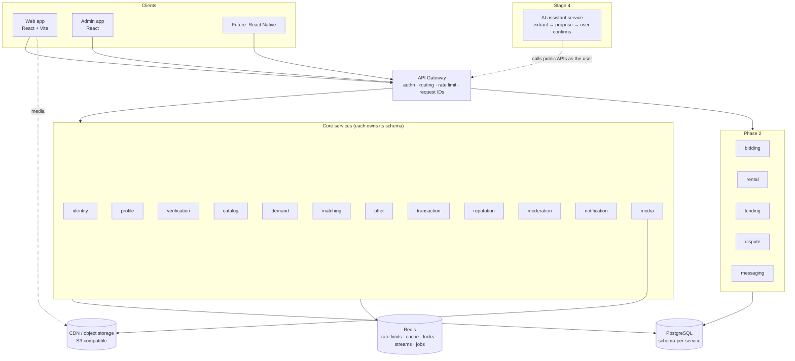

# 01 — System Architecture

## 1. High-level architecture

The core model is **demand → matching → offers → transaction → reputation**.
Listings are a _second source of supply_ that feed matching; they are not the
centre of the product.



Key properties:

- **Gateway** is thin: TLS termination, JWT verification (JWKS from identity),
  coarse rate limits, request/correlation IDs, routing. No business logic.
- **Every service owns its data** in its own Postgres schema with its own DB
  role. No service reads another service's tables. Cross-service data arrives
  via events (local projections) or explicit internal APIs.
- **PostgreSQL is the source of truth.** Redis holds only reconstructible
  state (throttles, caches, locks, stream transport). Events are durable in
  each service's Postgres outbox, so losing Redis loses nothing that cannot be
  replayed.
- **AI is a client, not a core component.** A future AI service turns natural
  language into a _draft_ Need and calls the same public APIs as the user, with
  the user's token, and every write requires explicit user confirmation. It
  can never authorize transactions or bypass policy.

## 2. Service responsibility map

We split by **business capability with an independent lifecycle and data**, not
by noun. Hire, Source, Buy, Rent, Borrow are _modes_ of a Need and of an Offer,
not separate services — their differences are in mode-specific term schemas
and policies, while the lifecycle (post → respond → negotiate → agree →
fulfil) is shared. Rental and Lending get their own services in Phase 2
because they own genuinely different invariants (calendars, deposits,
returns).

| Service          | Owns (source of truth)                                                                                                                                                      | Key invariants                                                                                           | Emits                                                                                                  | MVP                                                      |
| ---------------- | --------------------------------------------------------------------------------------------------------------------------------------------------------------------------- | -------------------------------------------------------------------------------------------------------- | ------------------------------------------------------------------------------------------------------ | -------------------------------------------------------- |
| **gateway**      | nothing (stateless)                                                                                                                                                         | every request has a request ID; tokens verified                                                          | —                                                                                                      | ✅                                                       |
| **identity**     | accounts, phone identities, OTP challenges, sessions, refresh tokens, devices, role grants                                                                                  | one account per normalized phone; OTP single-use, attempt-limited; refresh rotation with reuse detection | `AccountCreated`, `UserLoggedIn`, `DeviceRegistered`, `DeviceRevoked`, `AccountStatusChanged`          | ✅                                                       |
| **profile**      | display profile, user type (individual/business), preferences, seller capabilities (categories served, service areas, delivery capability), reputation summary _projection_ | profile ⟂ identity data (no phone in profile)                                                            | `ProfileUpdated`, `SellerCapabilitiesChanged`                                                          | ✅                                                       |
| **verification** | verification records (phone/device/NID), verification **policies**, provider references, verification audit                                                                 | policy-driven requirement checks; minimal NID storage                                                    | `UserVerified`, `VerificationRevoked`                                                                  | ✅ (phone + policy engine; NID provider adapter stubbed) |
| **catalog**      | category tree, attribute schemas per category, listings (product/used/new/service/rental listing), listing search index                                                     | listing attributes validate against category schema                                                      | `ListingPublished`, `ListingUpdated`, `ListingWithdrawn`                                               | ✅                                                       |
| **demand**       | Needs (structured requirement, mode, attributes JSONB), need lifecycle, expiry                                                                                              | state machine; expiry is server-driven                                                                   | `NeedPublished`, `NeedUpdated`, `NeedClosed`, `NeedExpired`                                            | ✅                                                       |
| **matching**     | match candidates & scores, matching rule config                                                                                                                             | deterministic, explainable scores; idempotent per (need, candidate)                                      | `MatchFound`                                                                                           | ✅ (rules)                                               |
| **offer**        | offers, counter-offers (negotiation rounds), acceptance slots per need                                                                                                      | at most N accepted per need (N = quantity policy); one live round per thread; acceptance atomic          | `OfferSubmitted`, `OfferCountered`, `OfferAccepted`, `OfferRejected`, `OfferWithdrawn`, `OfferExpired` | ✅                                                       |
| **transaction**  | transactions/orders, state machine, payment records via `PaymentProvider`, delivery arrangements via `DeliveryProvider`                                                     | explicit transitions only; one transaction per accepted offer                                            | `TransactionCreated`, `TransactionStateChanged`, `TransactionCompleted`, `TransactionCancelled`        | ✅ (cash, self-arranged)                                 |
| **reputation**   | reviews, reputation signals, computed summaries                                                                                                                             | one review per party per transaction; only after completion                                              | `ReviewCreated`, `ReputationRecomputed`                                                                | ✅                                                       |
| **moderation**   | reports, moderation cases, moderation decisions                                                                                                                             | decisions are commands to the owning service; all audited                                                | `ContentModerated`, `UserSanctioned`                                                                   | ✅                                                       |
| **notification** | notification inbox, channel preferences, delivery attempts                                                                                                                  | idempotent per (event, recipient, channel)                                                               | —                                                                                                      | ✅ (in-app + SMS)                                        |
| **media**        | upload sessions, media objects metadata, scan/processing status                                                                                                             | content type sniffed server-side; private by default                                                     | `MediaReady`, `MediaRejected`                                                                          | ✅                                                       |
| **bidding**      | auctions (forward & reverse), bids, bid history                                                                                                                             | atomic bid validation under row lock; deadline enforced in DB clock                                      | `AuctionOpened`, `BidPlaced`, `BidOutbid`, `AuctionClosed`                                             | ✅                                                       |
| **rental**       | rental availability calendars, bookings, deposits, handover/return                                                                                                          | no overlapping bookings (`EXCLUDE USING gist`)                                                           | `RentalBooked`, `RentalReturned`                                                                       | ✅                                                       |
| **lending**      | borrow requests, loans, return confirmations, lender/borrower history                                                                                                       | trust-gated; not priced; deposits optional                                                               | `LoanStarted`, `LoanReturned`                                                                          | ✅                                                       |
| **dispute**      | disputes, evidence, resolutions                                                                                                                                             | resolution commands transaction transitions                                                              | `DisputeOpened`, `DisputeResolved`                                                                     | ✅                                                       |
| **messaging**    | conversations bound to a context (need/listing/offer/transaction)                                                                                                           | participants-only access; phone numbers never exposed                                                    | `MessageSent`                                                                                          | ✅                                                       |
| **dashboard**    | read models: daily metrics, gauges, cross-service activity log (from `audit.ActivityRecorded`), per-user dashboards                                                         | read-only; rebuildable by replaying streams; never on a write path                                       | —                                                                                                      | ✅ (ADR-0010)                                            |

**Admin** actions are not a service. Each service exposes `/api/v1/admin/...`
routes protected by granular permissions; the admin web app talks to them via
the gateway. Read-side aggregation (platform metrics, the cross-service activity
log, personal dashboards) lives in the **dashboard** service, a read-only BFF fed
by events (ADR-0010).

**Search** lives in each owning service (Postgres FTS + `pg_trgm` + GIN on
JSONB) behind a `SearchIndex` port. A dedicated search service consuming
`Listing*`/`Need*` events is a drop-in replacement later
(OpenSearch/Meilisearch adapter).

## 3. Layering inside a service (clean architecture)

```
interfaces/      HTTP routes (Fastify + Zod schemas), event consumers, jobs
   ↓ calls
application/     use cases (one class/function per command/query), ports (interfaces)
   ↓ uses
domain/          entities, value objects, state machines, policies — pure TS, no I/O
   ↑ implemented by
infrastructure/  Postgres repositories (Kysely), Redis, SMS/payment/delivery adapters
config/          env schema (Zod) → typed config; composition root wires adapters to ports
```

Rules (enforced by lint import boundaries):

- `domain` imports nothing outside `domain` (and `@dorkar/kernel` pure utilities).
- `application` depends on `domain` and on **ports** it declares; never on
  `infrastructure`.
- Routes only: parse/validate → call one use case → map result to response DTO.
- Response DTOs are explicit mappers — never serialize DB rows or entities
  directly (prevents leaking internal fields and mass assignment).

## 4. Communication

```mermaid
sequenceDiagram
  autonumber
  participant B as Buyer (web)
  participant GW as Gateway
  participant DEM as demand
  participant OB as Outbox relay
  participant BUS as Event bus (Redis Streams)
  participant MAT as matching
  participant NOT as notification
  participant S as Seller (web)
  participant OFF as offer
  participant TRX as transaction

  B->>GW: POST /api/v1/needs
  GW->>DEM: forward (verified JWT claims)
  DEM->>DEM: TX: insert need + outbox(NeedPublished)
  DEM-->>B: 201 Need
  OB->>BUS: publish NeedPublished (at-least-once)
  BUS->>MAT: NeedPublished
  MAT->>MAT: score candidates (projections of listings & seller capabilities)
  MAT->>BUS: MatchFound × k
  BUS->>NOT: MatchFound → notify sellers
  S->>GW: POST /api/v1/needs/:id/offers
  GW->>OFF: forward
  OFF->>OFF: TX: validate against need projection, insert offer + outbox
  BUS->>NOT: OfferSubmitted → notify buyer
  B->>GW: POST /api/v1/offers/:id/accept (Idempotency-Key)
  OFF->>OFF: TX: lock acceptance slot, mark ACCEPTED + outbox(OfferAccepted)
  BUS->>TRX: OfferAccepted
  TRX->>TRX: TX: create transaction (unique offer_id) + outbox
  BUS->>DEM: TransactionCreated → need FULFILLING
```

### Synchronous vs asynchronous

| Use                      | When                                                                                                           | Mechanism                                                                                                                               |
| ------------------------ | -------------------------------------------------------------------------------------------------------------- | --------------------------------------------------------------------------------------------------------------------------------------- |
| **Sync (internal HTTP)** | the caller _cannot proceed_ without a fresh answer, e.g. verification policy check before publishing a listing | `GET /internal/v1/...`, service token, short timeout (≤300 ms), circuit breaker, explicit fallback (fail-closed for security decisions) |
| **Async (events)**       | everything that is a reaction: matching, notifications, projections, reputation, need status follow-ups        | transactional **outbox** → relay → Redis Streams consumer groups                                                                        |

### Event delivery guarantees

1. **Outbox**: the event row is written in the same DB transaction as the
   state change. No dual writes.
2. **Relay**: polls `outbox` with `FOR UPDATE SKIP LOCKED`, publishes,
   marks `published_at`. At-least-once.
3. **Consumers are idempotent**: each consumer records `(consumer, event_id)` in
   its own `inbox` table inside the same transaction as its side effects; a
   duplicate is a no-op.
4. **Retries** with exponential backoff; after N failures the message goes to a
   **dead-letter stream** with the error, surfaced in metrics and an admin view.
5. **Event envelope** (versioned, schema-validated by `@dorkar/contracts`):

```json
{
  "id": "0192f0c4-…", // UUIDv7, also the idempotency key
  "type": "demand.NeedPublished",
  "version": 1,
  "occurredAt": "2026-10-01T10:00:00.000Z",
  "producer": "demand",
  "aggregateId": "…",
  "correlationId": "…", // propagated from the originating request
  "causationId": "…", // event or request that caused this one
  "payload": {}
}
```

Why Redis Streams, not Kafka/RabbitMQ: we already run Redis, volume is modest,
and the outbox makes the broker replaceable (see ADR-0003). The `EventBus` port
has one adapter today; NATS JetStream or RabbitMQ can replace it without
touching producers or consumers.

## 5. Cross-cutting decisions

| Concern     | Decision                                                                                                                                                                    |
| ----------- | --------------------------------------------------------------------------------------------------------------------------------------------------------------------------- |
| IDs         | UUIDv7 generated in the app (time-ordered → good B-tree locality, safe to expose, non-enumerable)                                                                           |
| Money       | `bigint` minor units (poisha) + `currency char(3)` = `'BDT'`; never floats                                                                                                  |
| Time        | `timestamptz` everywhere, UTC in APIs (ISO-8601); deadlines compared with DB `now()`                                                                                        |
| Pagination  | cursor-based (`(created_at, id)` keyset), opaque base64url cursor                                                                                                           |
| Config      | Zod-validated env vars per service; fail fast at boot; business rules in DB-backed `policy`/`setting` tables with audit                                                     |
| Idempotency | `Idempotency-Key` header on critical POSTs, stored per service in `idempotency_keys` (key, actor, request hash, response)                                                   |
| Audit       | per-service append-only `audit_log` table (UPDATE/DELETE blocked by trigger), written in the same TX as the action; also emitted as events for a future central audit store |
| Errors      | `{ error: { code, message, details?, requestId } }`, stable `code` strings                                                                                                  |
| Validation  | Zod schemas for requests _and_ responses (Fastify serializer validates outgoing DTOs)                                                                                       |

## 6. Repository layout

```
dorkar/
  apps/
    web/                 React + Vite consumer app
    admin/               React admin app (later)
  services/
    gateway/
    identity-service/
    profile-service/ … (one folder per service)
      src/
        domain/
        application/
        infrastructure/
        interfaces/
        config/
      migrations/
      tests/
  packages/
    kernel/              platform kit: config, logger, errors, HTTP bootstrap, db, outbox, idempotency, audit, rate limit
    contracts/           event envelope + event payload schemas, shared enums, error codes
  infra/
    docker/              compose, shared service.Dockerfile, postgres init (schemas + roles)
    k6/                  load tests
    backup/              backup/restore scripts
  docs/
  .github/workflows/
```

## 7. Evolution stages

| Stage | Adds                                                                                                                                                                                 | Trigger to move on |
| ----- | ------------------------------------------------------------------------------------------------------------------------------------------------------------------------------------ | ------------------ |
| 1     | Gateway, core services, Postgres, Redis, outbox/streams                                                                                                                              | MVP launch         |
| 2     | Object storage + CDN (media), background workers, bidding/rental/lending, observability stack (OTel → Prometheus/Grafana/Tempo), search engine **if** Postgres FTS p95 > target      | real traffic       |
| 3     | `PaymentProvider` adapters (bKash, Nagad, cards, escrow), `DeliveryProvider` adapters (Pathao, Steadfast, RedX), NID provider, mobile apps with device-bound keys, advanced matching | product-market fit |
| 4     | AI assistant, AI-assisted matching (as a `MatchScorer` implementation), NL Need creation, offer comparison                                                                           | stable core        |
