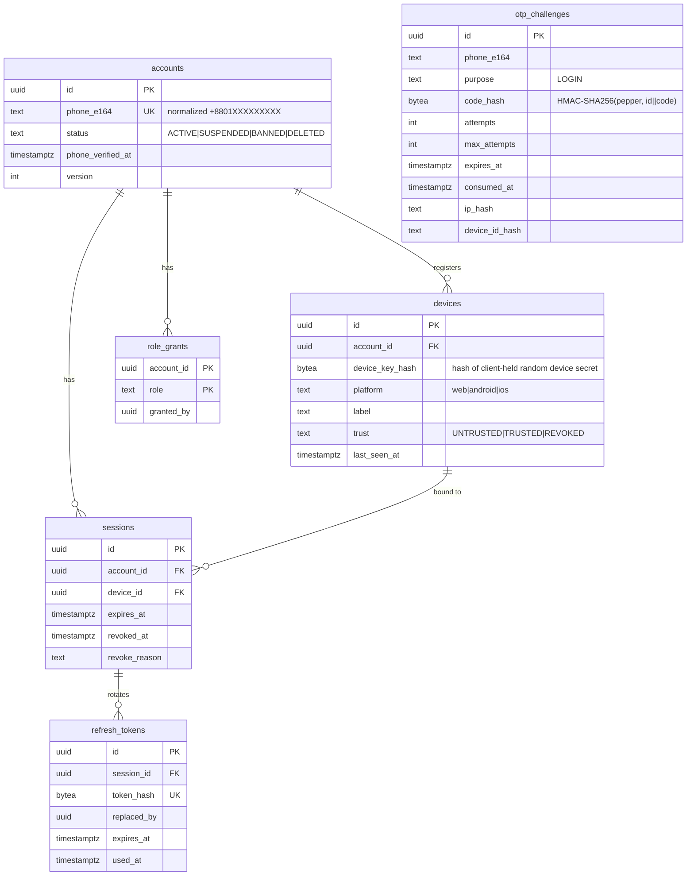

# 02 — Data Architecture

## 1. Database architecture

**One PostgreSQL cluster, one database (`dorkar`), one schema + one login role
per service.**

```
cluster
└── database dorkar
    ├── schema identity      ← role svc_identity     (owner)
    ├── schema profile       ← role svc_profile
    ├── schema verification  ← role svc_verification
    ├── schema catalog       ← role svc_catalog
    ├── schema demand        ← role svc_demand
    ├── schema offer         ← role svc_offer
    ├── schema txn           ← role svc_transaction
    └── …
```

- Each role has `USAGE/CREATE` **only on its own schema** and its
  `search_path` is set to that schema. A service physically cannot join
  another service's tables. This is enforced by
  [`infra/docker/postgres/init.sql`](../../infra/docker/postgres/init.sql).
- Cost: one small instance serves all services in Stage 1. Splitting a hot
  service out later is `pg_dump -n <schema>` → restore into a new cluster →
  change that service's `DATABASE_URL`. No code changes.
- Only standard, widely available features are used: `jsonb`, GIN,
  `pg_trgm`, `btree_gist`, `citext`, partial/expression indexes, `EXCLUDE`
  constraints, row locks, `SKIP LOCKED`. All are available on stock Postgres
  ≥ 14 and on every major managed offering (RDS, Cloud SQL, Azure, DO). No
  proprietary extensions, no logical-replication-only features in the
  application path.
- Connection: `DATABASE_URL` per service (+ `DATABASE_POOL_MAX`,
  `DATABASE_SSL`). Pooling in-process (`pg.Pool`); PgBouncer in transaction
  mode can be added in front without code changes (we avoid session-level
  state such as `SET` outside transactions and advisory session locks).

### Data-shape conventions

| Convention             | Rule                                                                                                                                                                                                                                         |
| ---------------------- | -------------------------------------------------------------------------------------------------------------------------------------------------------------------------------------------------------------------------------------------- |
| Primary keys           | `uuid` (UUIDv7 from the app)                                                                                                                                                                                                                 |
| Timestamps             | `created_at`, `updated_at timestamptz not null default now()`                                                                                                                                                                                |
| Optimistic concurrency | `version int not null default 0` on mutable aggregates; updates use `WHERE id = $1 AND version = $2`                                                                                                                                         |
| Soft state             | lifecycle via `status` enum-like `text` + `CHECK`; no `deleted` booleans for business objects                                                                                                                                                |
| Money                  | `*_amount bigint` (poisha) + `currency char(3)`                                                                                                                                                                                              |
| Flexible attributes    | `attributes jsonb not null default '{}'`, validated against the category's JSON schema in the app; GIN `jsonb_path_ops` index                                                                                                                |
| Location               | `division`, `district`, `area` codes (BD admin hierarchy) + optional `geo_lat/geo_lng numeric(9,6)`. PostGIS is deliberately **not** required; distance filtering uses bounding boxes on btree indexes until a real need for PostGIS appears |
| Enums                  | `text` + `CHECK (status IN (...))` — easier to migrate than PG enums                                                                                                                                                                         |

## 2. Shared tables every service gets (from `@dorkar/kernel`)

| Table               | Purpose                                                                                                                                                                                                                                                                                                                                          |
| ------------------- | ------------------------------------------------------------------------------------------------------------------------------------------------------------------------------------------------------------------------------------------------------------------------------------------------------------------------------------------------ |
| `schema_migrations` | applied migrations (Kysely migrator)                                                                                                                                                                                                                                                                                                             |
| `outbox`            | events pending publication (`id, type, version, aggregate_id, payload jsonb, correlation_id, causation_id, occurred_at, published_at, attempts`) — partial index `WHERE published_at IS NULL`                                                                                                                                                    |
| `inbox`             | consumed event IDs per consumer for idempotency (`consumer, event_id` PK)                                                                                                                                                                                                                                                                        |
| `idempotency_keys`  | `(actor_id, scope, key)` PK, `request_hash`, `status`, `response_status`, `response_body jsonb`, `expires_at`                                                                                                                                                                                                                                    |
| `audit_log`         | append-only: `id, occurred_at, actor_id, actor_type, action, target_type, target_id, request_id, ip_hash, metadata jsonb`. A trigger rejects `UPDATE`/`DELETE`; the service role has only `INSERT, SELECT`. Retention is handled by a privileged maintenance role that drops old **partitions** (monthly partitioning once volume justifies it). |

## 3. Schemas & ERD

Below, `→ x` means "references an ID owned by service x" — stored as a plain
`uuid` with **no cross-schema foreign key**.

### identity (implemented)



### profile

| Table                 | Key columns                                                                                                                                                                              |
| --------------------- | ---------------------------------------------------------------------------------------------------------------------------------------------------------------------------------------- |
| `profiles`            | `account_id PK →identity`, `display_name`, `user_type ('INDIVIDUAL','BUSINESS')`, `avatar_media_id →media`, `bio`, `home_division/district/area`, `locale ('bn','en')`, `version`        |
| `seller_capabilities` | `account_id PK`, `roles text[]` (`SELLER`,`SERVICE_PROVIDER`,`LENDER`,`SUPPLIER`), `category_ids uuid[]`, `service_areas jsonb`, `delivery_modes text[]`, `accepts_custom_sourcing bool` |
| `preferences`         | `account_id PK`, `notification_prefs jsonb`, `privacy_prefs jsonb`                                                                                                                       |
| `reputation_summary`  | projection from reputation: `account_id PK`, `completed_count`, `cancelled_count`, `dispute_count`, `rating_avg numeric(3,2)`, `rating_count`, `response_rate`, `updated_at`             |

### verification

| Table                   | Key columns                                                                                                                                                                                                                                                   |
| ----------------------- | ------------------------------------------------------------------------------------------------------------------------------------------------------------------------------------------------------------------------------------------------------------- |
| `verifications`         | `id`, `account_id`, `kind ('PHONE','DEVICE','NID','BUSINESS')`, `status ('PENDING','VERIFIED','REJECTED','REVOKED','EXPIRED')`, `provider`, `provider_ref` (opaque reference at the provider), `verified_at`, `expires_at`                                    |
| `nid_vault`             | _only if a provider cannot hold the data_: `verification_id PK`, `nid_number_enc bytea` (AES-256-GCM, envelope key from KMS/secret), `nid_last4`, `name_match bool`, `dob_year smallint`, `retention_until`. Separate DB role for read; every read audited    |
| `verification_policies` | `id`, `name`, `scope ('GLOBAL','ROLE','CATEGORY','TRANSACTION_MODE','VALUE_THRESHOLD')`, `selector jsonb` (e.g. `{"categoryId":"…"}`, `{"minAmount":5000000}`), `requirement ('NONE','OPTIONAL','REQUIRED')`, `kinds text[]`, `active`, `priority`, `version` |
| `policy_changes`        | audit of policy edits (who/when/before/after)                                                                                                                                                                                                                 |

Policy evaluation: `evaluate(subject, action, context) → {required: Kind[], satisfied: bool, missing: Kind[]}`. Most-specific active policy wins; ties by `priority`. Policies are data, edited via admin API, versioned and audited — never hard-coded.

### catalog

| Table           | Key columns / indexes                                                                                                                                                                                                                                                                                                                                                                                                                                                        |
| --------------- | ---------------------------------------------------------------------------------------------------------------------------------------------------------------------------------------------------------------------------------------------------------------------------------------------------------------------------------------------------------------------------------------------------------------------------------------------------------------------------- |
| `categories`    | `id`, `parent_id`, `slug UK`, `name_en`, `name_bn`, `modes text[]` (allowed: `BUY`,`RENT`,`BORROW`,`HIRE`,`SOURCE`), `attribute_schema jsonb` (JSON Schema subset), `attribute_schema_version`, `sort`, `active`                                                                                                                                                                                                                                                             |
| `listings`      | `id`, `seller_id →identity`, `category_id`, `kind ('PRODUCT','SERVICE','RENTAL')`, `condition ('NEW','USED','REFURBISHED')`, `title`, `description`, `price_amount`, `price_unit ('TOTAL','PER_HOUR','PER_DAY','PER_UNIT')`, `currency`, `quantity_available`, `attributes jsonb`, `location (division, district, area, lat, lng)`, `delivery_modes text[]`, `status ('DRAFT','PUBLISHED','PAUSED','SOLD_OUT','WITHDRAWN','HIDDEN')`, `search tsvector GENERATED`, `version` |
| `listing_media` | `listing_id`, `media_id →media`, `position`                                                                                                                                                                                                                                                                                                                                                                                                                                  |

Indexes: `(status, category_id, created_at desc, id)`, `(seller_id, created_at desc)`, GIN on `search`, GIN `pg_trgm` on `title`, GIN `jsonb_path_ops` on `attributes`, `(district, status)`.

### demand (Needs)

| Table                 | Key columns                                                                                                                                                                                                                                                                                                                                                                                                                                                                                                                                                                                                   |
| --------------------- | ------------------------------------------------------------------------------------------------------------------------------------------------------------------------------------------------------------------------------------------------------------------------------------------------------------------------------------------------------------------------------------------------------------------------------------------------------------------------------------------------------------------------------------------------------------------------------------------------------------- |
| `needs`               | `id`, `requester_id →identity`, `mode ('BUY','RENT','BORROW','HIRE','SOURCE')`, `category_id →catalog`, `title`, `description`, `quantity int`, `budget_min_amount`, `budget_max_amount`, `currency`, `budget_flexible bool`, `condition_pref text[]`, `attributes jsonb` (category-specific, schema-validated), `mode_terms jsonb` (mode-specific, schema-validated — see below), `location`, `delivery_pref ('PICKUP','DELIVERY','EITHER')`, `required_by date`, `expires_at`, `visibility ('PUBLIC','MATCHED_ONLY')`, `status`, `offer_count`, `accepted_quantity`, `search tsvector GENERATED`, `version` |
| `need_attachments`    | `need_id`, `media_id`, `position`                                                                                                                                                                                                                                                                                                                                                                                                                                                                                                                                                                             |
| `need_status_history` | append-only transitions with actor + reason                                                                                                                                                                                                                                                                                                                                                                                                                                                                                                                                                                   |

`mode_terms` schemas (validated by Zod, versioned):

- **BUY**: `{ acceptsUsed, warrantyRequired }`
- **RENT**: `{ startAt, endAt, durationUnit, depositAcceptable }`
- **BORROW**: `{ startAt, returnBy, purpose, depositOffered }`
- **HIRE**: `{ serviceDate, serviceWindow, durationEstimate, onSite, skills[] }`
- **SOURCE**: `{ specifications, customization, qualityRequirements, sampleRequired, supplierRequirements, deliveryDeadline }`

Indexes: `(status, category_id, created_at desc, id)`, `(requester_id, status)`, `(status, expires_at)` for the expiry job, GIN on `search` and `attributes`.

### matching

| Table                                                        | Key columns                                                                                                                                                                                                                                                     |
| ------------------------------------------------------------ | --------------------------------------------------------------------------------------------------------------------------------------------------------------------------------------------------------------------------------------------------------------- |
| `need_projection`, `listing_projection`, `seller_projection` | read models built from events (only fields matching needs)                                                                                                                                                                                                      |
| `matches`                                                    | `need_id`, `candidate_type ('LISTING','SELLER')`, `candidate_id`, `score numeric`, `reasons jsonb` (explainable per-factor scores), `scorer ('rules@v1')`, `status ('NEW','NOTIFIED','DISMISSED','RESPONDED')`; `UNIQUE(need_id, candidate_type, candidate_id)` |
| `match_rules`                                                | factor weights and hard filters per category/mode (config, audited)                                                                                                                                                                                             |

### offer

| Table               | Key columns                                                                                                                                                                                                                                                                                                                                                         |
| ------------------- | ------------------------------------------------------------------------------------------------------------------------------------------------------------------------------------------------------------------------------------------------------------------------------------------------------------------------------------------------------------------- |
| `need_projection`   | `need_id`, `requester_id`, `status`, `mode`, `quantity`, `accepted_quantity`, `max_offers`, `expires_at` (from `demand.*` events; offers can only target `OPEN` needs)                                                                                                                                                                                              |
| `offers`            | `id`, `need_id`, `seller_id`, `listing_id?`, `status`, `price_amount`, `currency`, `quantity`, `condition`, `availability_from`, `delivery_terms jsonb`, `mode_terms jsonb` (rental period / service scope / warranty / sourcing lead time), `description`, `expires_at`, `current_round`, `version`; `UNIQUE (need_id, seller_id) WHERE status IN (live statuses)` |
| `offer_rounds`      | negotiation history: `offer_id`, `round`, `proposed_by ('BUYER','SELLER')`, `price_amount`, `quantity`, `terms jsonb`, `message`, `created_at` — immutable                                                                                                                                                                                                          |
| `offer_attachments` | `offer_id`, `media_id`                                                                                                                                                                                                                                                                                                                                              |

### transaction

| Table                     | Key columns                                                                                                                                                                                                                                                                                                                               |
| ------------------------- | ----------------------------------------------------------------------------------------------------------------------------------------------------------------------------------------------------------------------------------------------------------------------------------------------------------------------------------------- |
| `transactions`            | `id`, `source_type ('OFFER','LISTING','AUCTION','RENTAL')`, `source_id` (`UNIQUE(source_type, source_id)` → exactly one transaction per accepted offer), `buyer_id`, `seller_id`, `mode`, `amount`, `currency`, `quantity`, `terms_snapshot jsonb` (frozen agreed terms), `state`, `buyer_confirmed_at`, `seller_confirmed_at`, `version` |
| `transaction_transitions` | append-only: `transaction_id`, `from_state`, `to_state`, `actor_id`, `reason`, `at`                                                                                                                                                                                                                                                       |
| `payments`                | `id`, `transaction_id`, `provider ('CASH', later 'BKASH','NAGAD','CARD','ESCROW')`, `status`, `amount`, `provider_ref`, `idempotency_key`                                                                                                                                                                                                 |
| `deliveries`              | `id`, `transaction_id`, `method ('SELF_ARRANGED','BUYER_PICKUP','SELLER_DELIVERY', later 'PATHAO'…)`, `status`, `provider_ref`, `address_snapshot jsonb` (minimal, retention-bound)                                                                                                                                                       |

### reputation / moderation / notification / media

- `reviews(id, transaction_id, author_id, subject_id, role, rating smallint 1–5, body, status)`, `UNIQUE(transaction_id, author_id)`.
- `reputation_signals(account_id, signal, value, window, computed_at)` — many signals, not one score.
- `reports(id, reporter_id, target_type, target_id, reason, details, status)`, `moderation_cases`, `moderation_actions(case_id, actor_id, action ('HIDE','RESTORE','SUSPEND','BAN','DISMISS'), target, reason)`.
- `notifications(id, recipient_id, type, payload, read_at)`, `notification_deliveries(notification_id, channel, status, attempts)`, `UNIQUE(source_event_id, recipient_id, channel)`.
- `media_objects(id, owner_id, purpose, storage_key, sniffed_mime, size_bytes, sha256, status ('PENDING_UPLOAD','SCANNING','READY','REJECTED'), variants jsonb, visibility)`.

### Phase 2 (designed, not built)

- **bidding**: `auctions(id, kind ('FORWARD','REVERSE'), owner_id, subject_type, subject_id, start_price, reserve_price, min_increment, starts_at, ends_at, anti_snipe_seconds, status, leading_bid_id, version)`, `bids(id, auction_id, bidder_id, amount, status, idempotency_key, placed_at)`, `UNIQUE(auction_id, bidder_id, idempotency_key)`.
- **rental**: `bookings(id, rental_listing_id, renter_id, period tstzrange, status, deposit_amount)`, `EXCLUDE USING gist (rental_listing_id WITH =, period WITH &&) WHERE (status IN ('HELD','CONFIRMED','ACTIVE'))` — double-booking is impossible at the DB level.
- **lending**: `loans(id, lender_id, borrower_id, item_ref, starts_at, return_by, deposit_amount?, status, returned_confirmed_by_lender_at)`.

## 4. Migrations

- Migrations live in `services/<svc>/migrations/NNNN_description.ts`, each with
  `up` and `down`, executed by the Kysely migrator in a transaction with a
  migration lock.
- **Expand → migrate → contract** for zero-downtime changes:
  1. _Expand_: add nullable column / new table / new index `CONCURRENTLY`
     (non-transactional migration flagged explicitly).
  2. Deploy code that writes both / reads new.
  3. Backfill in batches via a job.
  4. _Contract_: drop old column in a later release.
- Destructive `down` migrations are allowed only for expand steps; contract
  steps document their manual recovery path (restore from backup) since data
  is gone.
- CI runs `migrate up → down → up` on a fresh database for every service to
  prove reversibility.
- Migrations run as a **separate one-shot container** (`node dist/migrate.js`)
  before the new version receives traffic; services never auto-migrate in
  production.
- Production schema changes outside migrations are forbidden. The service
  role cannot `ALTER` other schemas; the migration role is used only by the
  migration job.
- Seeds: `seeds/` per service, idempotent (`ON CONFLICT DO NOTHING`);
  `reference` seeds (categories, policies) run in every env, `demo` seeds only
  in dev/staging.

## 5. Backup, restore & disaster recovery

### Targets

| Metric                | Target (Stage 1)                                       |
| --------------------- | ------------------------------------------------------ |
| RPO (max data loss)   | ≤ 5 minutes with WAL archiving; ≤ 24 h with dumps only |
| RTO (time to restore) | ≤ 2 hours                                              |

### Layers

1. **Physical + WAL (PITR)**
   - Managed PG: enable provider PITR (7–14 days).
   - Self-hosted (VPS/droplet): **pgBackRest** (or WAL-G) with full weekly,
     differential daily, continuous WAL archiving to S3-compatible storage
     (DO Spaces / R2 / B2 / S3), encrypted (AES-256) client-side.
2. **Logical dumps (portability)** — nightly
   `pg_dump --format=custom --no-owner --no-acl` of the whole DB **and** per
   schema, encrypted with `age`, uploaded to a _different provider_ than the
   database lives on. Retention: 7 daily, 4 weekly, 12 monthly.
3. **Restore drills** — weekly CI job restores the latest logical dump into a
   throwaway Postgres container, runs migrations status check + row-count and
   checksum sanity queries, and alerts on failure. A backup that has never
   been restored is not a backup.

### Runbook: move Postgres to a new provider (e.g. managed → droplet)

Scripts: [`infra/backup/`](../../infra/backup/).

```bash
# 0. Provision target Postgres (same major version or newer), create roles
psql "$TARGET_ADMIN_URL" -f infra/docker/postgres/init.sql

# 1. Put the platform in maintenance mode (gateway returns 503 for writes)
# 2. Final dump from source
pg_dump "$SOURCE_URL" --format=custom --no-owner --no-acl --file=dorkar.dump
# 3. Restore to target
pg_restore --dbname="$TARGET_ADMIN_URL" --no-owner --role=postgres --jobs=4 dorkar.dump
psql "$TARGET_ADMIN_URL" -f infra/docker/postgres/grants.sql   # re-apply role grants
# 4. Verify: row counts per table, latest migration per schema, smoke queries
infra/backup/verify.sh "$SOURCE_URL" "$TARGET_ADMIN_URL"
# 5. Point services to target: update DATABASE_URL secrets, rolling restart
# 6. Run smoke tests, leave maintenance mode
# 7. Keep source read-only for 7 days, then decommission
```

For near-zero-downtime moves on larger data, use logical replication
(publication on source, subscription on target) for the cut-over window — this
is an _operational_ tool only; the application never depends on it.

### Redis loss

Redis holds no source-of-truth data. On loss: rate-limit counters reset
(acceptable), caches refill, outbox relay re-publishes all unpublished events,
consumers dedupe via `inbox`. Jobs are re-derived from Postgres state (e.g. the
need-expiry job scans `needs WHERE status='OPEN' AND expires_at < now()`).

## 6. Data export / portability

- Every service exposes an admin-only, audited `export` job producing NDJSON
  per aggregate (users, listings, needs, offers, bids, transactions, reviews,
  disputes, audit records) into object storage with a signed download URL.
- User-level export (data subject access) is assembled by fan-out over the
  same per-service exporters filtered by `account_id`.
- Import: idempotent loaders keyed on primary IDs (UUIDv7 IDs survive moves).
