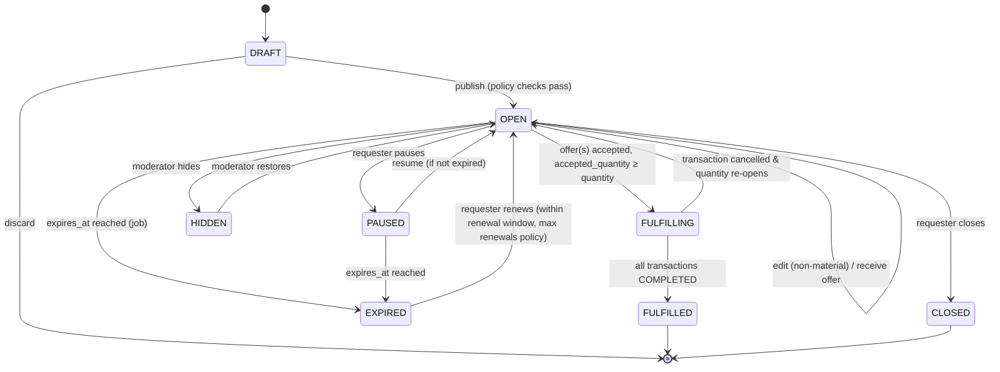
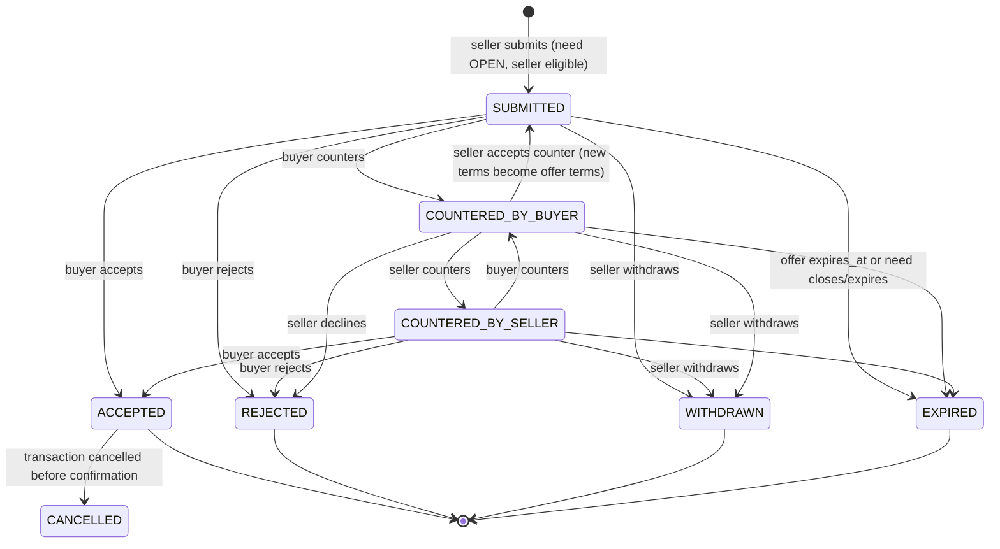
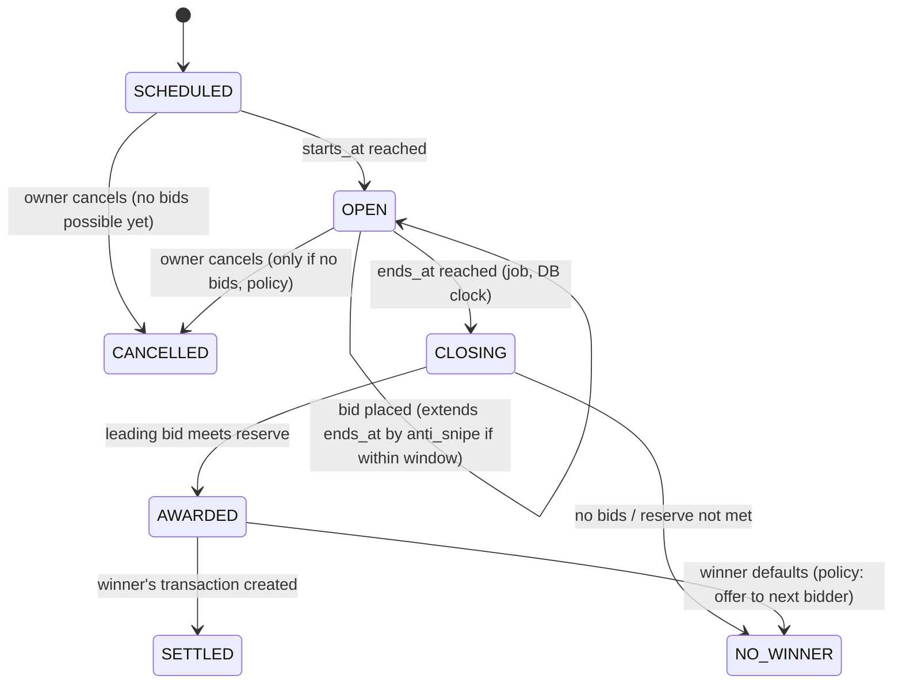
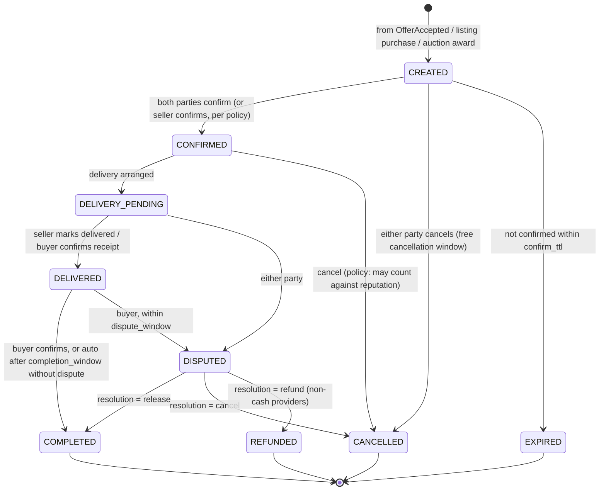

# 03 — Lifecycles & State Machines

Every aggregate with a lifecycle has **one** transition table in its domain
layer (`domain/<aggregate>-state-machine.ts`). Application services call
`machine.transition(current, event, ctx)`; nothing else may assign `status`.
Every successful transition is persisted together with a history row and an
outbox event in one DB transaction, guarded by
`UPDATE … WHERE id = $1 AND status = $from AND version = $v` so concurrent
transitions cannot both succeed.

## 1. Need



Rules (configurable via policies/settings, not code):

- `need.default_ttl_days` (e.g. 14), `need.max_ttl_days`, `need.max_renewals`.
- `need.max_open_per_user` (anti-spam), `need.max_offers` per need (default 50).
- **Material edits** (category, mode, quantity decrease below accepted,
  budget reduced) while offers exist → existing live offers are flagged
  `NEEDS_RECONFIRM` (seller is notified) rather than silently changed.
- Verification policy evaluated at `publish` (e.g. high-value SOURCE needs may
  require NID).

## 2. Offer (with negotiation)



- Each counter creates an immutable `offer_rounds` row; the party who did
  **not** make the latest round is the only one who can accept it.
- `negotiation.max_rounds` (default 5) per offer.
- **Exclusive acceptance**: inside one DB transaction, the offer service locks
  the need's row in its `need_projection` (`SELECT … FOR UPDATE`), checks
  `accepted_quantity + offer.quantity ≤ quantity`, transitions the offer with
  a status/version guard, increments `accepted_quantity`, writes the outbox
  event. Two concurrent accepts for the last unit serialize on the lock; the
  second gets `409 NEED_QUANTITY_EXHAUSTED`. The API requires
  `Idempotency-Key`.
- When a need becomes fully accepted, remaining live offers transition to
  `EXPIRED` (reason `NEED_FULFILLED`) asynchronously.

## 3. Bid / Auction (Phase 2)



Bid states: `ACCEPTED (leading) → OUTBID`, `REJECTED`, `RETRACTED` (only within
`bid.retraction_window` and only if policy allows), `WON`, `LOST`.

**Atomic bid placement** (single DB transaction):

```sql
BEGIN;
SELECT … FROM auctions WHERE id = $1 FOR UPDATE;               -- serialize bids per auction
-- validate in app with values read under lock + DB now():
--   status = 'OPEN' AND now() < ends_at
--   bidder ≠ owner, bidder eligible (verification policy), not banned
--   FORWARD: amount ≥ max(start_price, leading + min_increment)
--   REVERSE: amount ≤ leading - min_increment (and ≤ budget ceiling)
INSERT INTO bids (…, idempotency_key) ON CONFLICT (auction_id, bidder_id, idempotency_key) DO NOTHING RETURNING …;
UPDATE bids SET status='OUTBID' WHERE id = <previous leading>;
UPDATE auctions SET leading_bid_id = …, ends_at = greatest(ends_at, now() + anti_snipe), version = version + 1 WHERE id = $1;
INSERT INTO outbox …  -- BidPlaced, BidOutbid
COMMIT;
```

The row lock is short (no network I/O inside the transaction). For very hot
auctions a Redis lock is **not** used for correctness — only Postgres is.

## 4. Transaction



- Note the spec's `OFFER_ACCEPTED` stage is represented by the transaction
  being **created from** an accepted offer (`source_type='OFFER'`); a
  transaction only exists once agreement exists.
- Transitions are a declarative table: `(from, command) → to, allowedActors,
guards[]`. Guards are small pure functions (`paymentSettled`,
  `withinDisputeWindow`, …).
- **Payment is a port**: `PaymentProvider.initiate/confirm/refund/status`.
  `CashPaymentProvider` records intent and marks paid on buyer+seller
  confirmation at `COMPLETED`. Future bKash/Nagad/escrow adapters add
  `PAYMENT_PENDING`/`PAYMENT_HELD` guards without changing the machine's core.
- **Delivery is a port**: `DeliveryProvider.arrange/track/cancel`.
  `SelfArrangedDelivery` just records method and confirmations.
- Mode-specific sub-flows (Phase 2): RENT adds `HANDED_OVER → RETURNED`,
  BORROW adds `LENT → RETURNED` with lender return confirmation, HIRE adds
  `SERVICE_SCHEDULED → SERVICE_DONE`. They extend the table, not replace it.

## 5. Rental booking (Phase 2)

`HELD (15 min) → CONFIRMED → ACTIVE (handed over) → RETURNED → CLOSED`, with
`CANCELLED`, `OVERDUE`, `DAMAGE_CLAIMED`. Holds that lapse are released by a
job. Overlap prevention is the `EXCLUDE` constraint, so even a bug in the app
cannot double-book.

## 6. Loan (borrow, Phase 2)

`REQUESTED → APPROVED → LENT → RETURN_REPORTED (borrower) → RETURNED (lender
confirms)`, plus `DECLINED`, `CANCELLED`, `OVERDUE`, `DISPUTED`. No price;
optional deposit; eligibility gated by reputation signals and verification
policy (e.g. lender may require NID-verified borrowers).
