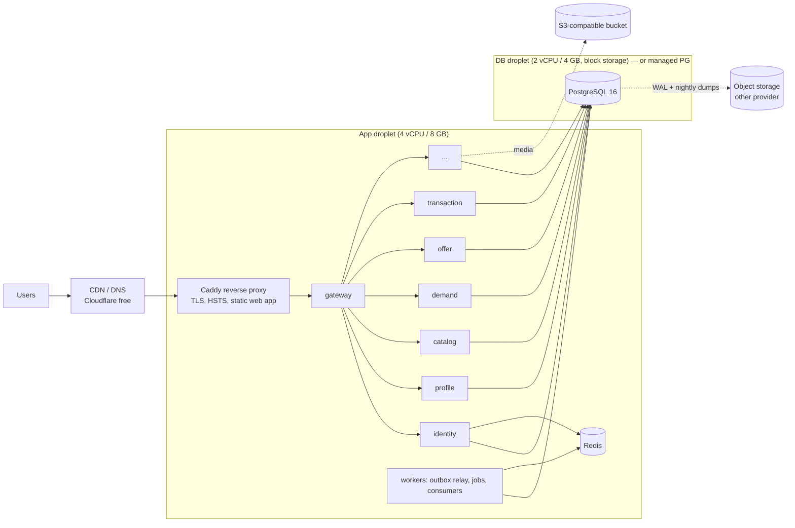

# 07 — Operations: Deployment, CI/CD, Testing, Observability, Cost

## 1. Deployment architecture

Everything ships as OCI images and runs anywhere Docker runs. No Kubernetes
until there is an operational reason (≥ ~10 hosts, autoscaling needs, or team
size).

### Stage 1 (launch) — single region, cost-first



- `docker compose` with per-environment override files, deployed by CI over
  SSH (or a tiny agent such as Watchtower pinned to tags). Services are small
  Node processes (~80–150 MB RSS each).
- Staging is the same topology on one smaller droplet.
- Postgres on its own host (or managed) from day one so app hosts are
  disposable.

### Stage 2+

Multiple app hosts behind a load balancer; services scaled independently
(`compose --scale` or Nomad/Kubernetes when justified); Postgres primary +
streaming replica (read replicas for search/feeds); Redis with persistence
off and a replica; OTel collector → Prometheus/Grafana/Loki/Tempo.

### Environments & config

| Env         | Purpose                            | Data                 |
| ----------- | ---------------------------------- | -------------------- |
| development | laptops, compose                   | seeds + demo data    |
| test/CI     | ephemeral containers               | created per run      |
| staging     | release candidates, restore drills | anonymized/synthetic |
| production  | live                               | real                 |

Config is 12-factor env vars, validated at boot with Zod; secrets come from
the platform's secret store (DO App secrets / AWS SM / Doppler / SOPS-encrypted
files) — never from git. `.env.example` documents every variable.

## 2. CI/CD

```mermaid
flowchart LR
  PR[Pull request] --> L[lint + format] --> T[typecheck] --> U[unit tests] --> I[integration tests<br/>Postgres + Redis services] --> M[migrations up/down/up] --> B[build] --> SEC[security: pnpm audit, osv-scanner, gitleaks, Trivy] --> D[docker build<br/>tag = git sha]
  D --> MAIN{merge to main}
  MAIN --> STG[deploy staging<br/>migrate job → rolling restart] --> E2E[Playwright E2E + k6 smoke] --> APPROVE[manual approval] --> PROD[deploy prod<br/>same image digest]
  PROD --> SMK[smoke + health gates] -->|fail| RB[rollback to previous tag]
```



- Turborepo-style affected builds via `pnpm --filter "...[origin/main]"` so a
  change to one service doesn't rebuild everything.
- Images are immutable, tagged `sha-<gitsha>` and `vX.Y.Z`; prod deploys pin
  the digest. Rollback = redeploy previous tag (migrations are
  backward-compatible by the expand/contract rule, so old code runs on the new
  schema).
- Production deploy requires green CI on the exact commit + environment
  protection approval.

## 3. Testing strategy

| Level          | Tooling                                               | What                                                                                                                                                                                                  | Gate                          |
| -------------- | ----------------------------------------------------- | ----------------------------------------------------------------------------------------------------------------------------------------------------------------------------------------------------- | ----------------------------- |
| Unit           | Vitest                                                | domain rules, state machines (exhaustive transition tables), phone normalization, pricing, matching scorers, authorization policies                                                                   | every PR, ≥ 90 % on `domain/` |
| Integration    | Vitest + real Postgres/Redis (compose services in CI) | repositories, migrations, outbox/inbox, locking/concurrency, rate limits                                                                                                                              | every PR                      |
| API / contract | Vitest + `fastify.inject`                             | request/response schemas, authn/z matrix (each route × role), error envelope, idempotency                                                                                                             | every PR                      |
| Concurrency    | Vitest with N parallel connections                    | double acceptance, bid races, double booking                                                                                                                                                          | every PR                      |
| E2E            | Playwright                                            | Register → OTP → profile → Post Need → receive offer → negotiate → accept → transaction → complete → review; Create listing → matched need → submit offer; Phase 2: auction → concurrent bids → close | staging, nightly              |
| Load           | k6                                                    | see targets below                                                                                                                                                                                     | weekly + before releases      |
| Security       | ZAP baseline on staging, dependency + secret scanning |                                                                                                                                                                                                       | nightly                       |

OTP in tests: a `RecordingSmsProvider` captures messages in-process for
integration tests; E2E uses the `file` SMS provider (dev/staging only — boot
fails if configured in production) and reads the code from the outbox file.

### Performance targets (Stage 1, per-service, at 200 RPS sustained on the Stage-1 hardware)

| Endpoint class                                        | p50     | p95      | p99      | error rate           |
| ----------------------------------------------------- | ------- | -------- | -------- | -------------------- |
| Reads by ID                                           | < 15 ms | < 50 ms  | < 120 ms | < 0.1 %              |
| Feeds / search                                        | < 40 ms | < 150 ms | < 300 ms | < 0.1 %              |
| Writes (need/offer/listing)                           | < 30 ms | < 120 ms | < 250 ms | < 0.1 %              |
| Bid placement (100 concurrent bidders on one auction) | < 40 ms | < 200 ms | < 400 ms | 0 incorrect outcomes |
| OTP request (excl. SMS provider latency)              | < 30 ms | < 100 ms | < 200 ms | —                    |

## 4. Observability

Status: logs, correlation, W3C trace context, Prometheus metrics, alert rules and a
Grafana dashboard are built (kernel + gateway + `infra/docker/observability/`). Trace
_export_ (OpenTelemetry SDK), error tracking and log shipping are the next steps.

### 4.1 Logs and correlation

- **Logs**: pino JSON to stdout; fields `time, level, service, env, version,
requestId, correlationId, traceId, actorId (when authenticated), route,
statusCode, durationMs`. Redaction list for secrets/PII (see 04-security).
  Shipped by the platform (Docker log driver → Loki/Better Stack).
- **Correlation**: gateway assigns `X-Request-Id` and `X-Correlation-Id`;
  services propagate them on outbound HTTP and into event envelopes;
  consumers set them in their log context — one ID follows a Need from POST to
  the seller's notification.

### 4.2 Trace context (W3C `traceparent`)

Implemented without an SDK in `packages/kernel/src/trace.ts`:

- **HTTP**: every server (gateway included) continues a valid incoming
  `traceparent` with a new span id for its hop, or starts a new trace when
  there is none or it is malformed. For public traffic the gateway is therefore
  where traces start. It forwards its own span as the upstream's parent. The
  value is on `req.ctx.traceparent`, and request logs carry `traceId`.
- **Internal HTTP client** (`createInternalClient`) sends `traceparent` from
  `ctx`, or from the current execution scope when no context is passed.
- **Events**: the envelope has an optional `traceparent` field
  (`EventEnvelopeSchema`, compatible: older producers omit it, and consumers
  ignore malformed values instead of dead-lettering). `runtime.event()` fills it
  from `ctx` or the current scope. It is stored in `outbox.traceparent`
  (`kernelOutboxTraceMigration`, `0000_kernel_outbox_trace`, in every service's
  migration list) and published by the relay. Consumers run each handler as a
  child span of the producer's span, so events emitted by a handler continue the
  same trace. Consumer log lines (`event handled` at debug, handler failures and
  dead-letters) carry `traceId`.
- **Execution scope**: the kernel runs HTTP handlers (from `preHandler`, after
  body parsing) and event handlers inside an `AsyncLocalStorage` scope holding
  the traceparent and the process metrics. That is how code that only gets a
  reduced context still propagates the trace.

**Next step: export.** Add an optional kernel module that starts the
OpenTelemetry Node SDK only when `OTEL_EXPORTER_OTLP_ENDPOINT` is set (disabled
by default) and exports to Tempo/Jaeger. It adopts the ids above, so services
need no changes: create server/consumer spans from `req.ctx.traceparent` and the
handler scope, and enable the pg/ioredis/undici auto-instrumentations for child
spans. It is not built yet, to keep the dependency footprint small until a
tracing backend is chosen.

### 4.3 Metrics

`GET /metrics` (Prometheus text format) on every service and the gateway:

- Enabled only when `METRICS_TOKEN` (≥ 32 chars) is set. Otherwise the route
  does not exist (404). An empty value counts as unset.
- Requires `Authorization: Bearer <METRICS_TOKEN>`, compared in constant time
  (over SHA-256 digests). A wrong or missing token gets `401`.
- Never routed publicly: the gateway route table does not list it, so
  services' `/metrics` cannot be reached through the edge. The gateway's own
  `/metrics` is token-guarded the same way, skips JWT authentication, and is
  still IP rate-limited. In production, also block `/metrics` at the reverse
  proxy and scrape over the private network.

One registry per process (`Metrics`, `packages/kernel/src/metrics.ts`,
`runtime.metrics`). Every series has the label `service`.

| Metric                                                                      | Type      | Labels                                                              | Source                                                                    |
| --------------------------------------------------------------------------- | --------- | ------------------------------------------------------------------- | ------------------------------------------------------------------------- |
| `process_*`, `nodejs_*` (CPU, memory, event-loop lag, GC)                   | default   | —                                                                   | prom-client, only when `METRICS_TOKEN` is set                             |
| `http_request_duration_seconds`                                             | histogram | `method`, `route` (template, or `unmatched`), `status_code`         | every request except `/health/*` and `/metrics`                           |
| `db_pool_connections_total` / `_idle`, `db_pool_clients_waiting`            | gauge     | —                                                                   | pg pool, read on scrape                                                   |
| `outbox_unpublished_count`, `outbox_oldest_unpublished_age_seconds`         | gauge     | —                                                                   | one indexed query on scrape, cached 5 s                                   |
| `events_published_total`, `outbox_publish_failures_total`                   | counter   | —                                                                   | outbox relay                                                              |
| `events_handled_total`                                                      | counter   | `type`, `outcome` = processed, duplicate, failed, dead_lettered     | stream consumer (types the service does not subscribe to are not counted) |
| `event_handle_duration_seconds`                                             | histogram | `type`                                                              | stream consumer                                                           |
| `consumer_group_lag`, `consumer_group_pending`, `dead_letter_stream_length` | gauge     | `stream` (producer)                                                 | `XINFO GROUPS` / `XLEN` on scrape, cached 5 s                             |
| `job_runs_total`                                                            | counter   | `job`, `outcome` = succeeded, failed, skipped (lock held elsewhere) | periodic jobs                                                             |
| `job_duration_seconds`                                                      | histogram | `job`                                                               | periodic jobs that acquired the lock                                      |
| `rate_limit_rejections_total`                                               | counter   | `route`                                                             | any `429 RATE_LIMITED` (services and edge)                                |
| `idempotency_replays_total`                                                 | counter   | `scope`                                                             | `withIdempotency` answering from a stored response                        |

Cardinality rules: label values are route templates, event types, job names
and idempotency scopes defined in code, plus fixed outcome sets. Anything else
becomes `other`. Never put ids, users or raw URLs in labels. Readings from
outside the process (outbox, Redis) are cached so frequent or concurrent scrapes
cannot load Postgres or Redis.

Not built yet (from the original target): Redis command latency, OTP sends and
SMS spend (identity-specific counters), cache hit ratio, DB query latency.

### 4.4 Running Prometheus and Grafana locally

```bash
# secrets.env must contain METRICS_TOKEN (≥ 32 chars), e.g.
#   node -e 'console.log(require("crypto").randomBytes(32).toString("hex"))'
docker compose -f infra/docker/compose.yml --profile observability up --build
# Prometheus  http://localhost:9090   (Status → Targets: 19 jobs, Alerts: the rules below)
# Grafana     http://localhost:3000   (admin / $GRAFANA_ADMIN_PASSWORD, default admin)
```

- The `observability` profile keeps the default `up` lean. Prometheus and
  Grafana start only with the profile.
- `scripts/gen-compose.mjs` generates both `compose.yml` and
  `observability/prometheus.yml` from `scripts/backend-services.mjs`: one
  scrape job per service (`identity-service`, …) plus `gateway`. The
  bearer token is read from a file
  (`authorization.credentials_file`). The Prometheus container writes it
  (mode 600) from `METRICS_TOKEN` at start, so the credential is never in a
  config file. The container refuses to start without the token.
- Grafana is provisioned with the Prometheus datasource and the **Dorkar
  overview** dashboard (`observability/grafana/dashboards/dorkar-overview.json`).
  Its panels: RED per service (rate, 5xx ratio, p95, slowest routes, status
  mix), outbox backlog and age, relay publish/failure rate, consumer outcomes,
  group lag, DLQ and pending, handler p95, job runs and duration, DB pool,
  rate-limit rejections and idempotency replays, event-loop lag and memory.
- Without Docker, `pnpm dev:setup` adds a `METRICS_TOKEN` to `.env.dev` (also
  to an existing one), and `pnpm dev:backend` passes it to every service and the
  gateway:
  `curl -H "Authorization: Bearer $METRICS_TOKEN" localhost:4001/metrics`.

### 4.5 Alerts

Rules in `infra/docker/observability/alerts.yml`. Shared-state gauges are
reported by every instance, so the rules aggregate them with `max by
(service)`. The thresholds are starting points; tune them once real baselines
exist.

| Alert                   | Condition                                                         | Severity |
| ----------------------- | ----------------------------------------------------------------- | -------- |
| `TargetDown`            | scrape failing 2 min (down, or token mismatch)                    | page     |
| `High5xxRate`           | > 2 % of a service's requests are 5xx for 5 min (min 0.1 req/s)   | page     |
| `HighP95Latency`        | p95 of a route > 500 ms for 10 min (SLO; min traffic 0.05 req/s)  | ticket   |
| `OutboxLag`             | oldest unpublished outbox event > 60 s                            | page     |
| `OutboxPublishFailures` | > 3 relay failures in 10 min                                      | ticket   |
| `EventsDeadLettered`    | any event dead-lettered in the last 15 min                        | page     |
| `DeadLetterBacklog`     | a DLQ stream non-empty for 30 min (needs triage and replay)       | ticket   |
| `ConsumerLagGrowing`    | group lag > 100 and still rising over 10 min                      | page     |
| `EventHandlerFailures`  | > 10 % of deliveries of a type failing (being retried) for 10 min | ticket   |
| `JobFailing`            | any periodic job failure in 30 min                                | ticket   |
| `DbPoolSaturated`       | queries waiting for a pool connection for 5 min                   | ticket   |
| `RateLimitSpike`        | > 5 req/s rejected by rate limits for 10 min                      | info     |

Still to wire when the platform exists: Alertmanager routing (no receiver is
configured locally), SMS spend spike, backup job and restore drill failures,
disk > 80 % (node exporter).

### 4.6 Health and errors

- **Health**: `GET /health/live` (process up), `GET /health/ready` (DB + Redis
  reachable, migrations at expected version). Load balancers use readiness;
  graceful shutdown flips readiness to failing, drains in-flight requests
  (`SHUTDOWN_GRACE_MS`), closes pools.
- **Errors**: Sentry-compatible (GlitchTip self-hosted is the cost-free option).
  Not wired yet.

## 5. Cost plan

Bangladesh-market launch, assume ≤ 50k MAU in year one.

| Item                     | Stage 1 choice                                                                                            | ~USD / month   |
| ------------------------ | --------------------------------------------------------------------------------------------------------- | -------------- |
| App host                 | 1× DO droplet 4 vCPU / 8 GB                                                                               | 48             |
| Database                 | 1× droplet 2 vCPU / 4 GB + 100 GB volume (self-managed PG + pgBackRest) **or** DO Managed PG basic (~$30) | 24–30          |
| Redis                    | on app host (no persistence needed)                                                                       | 0              |
| Object storage + CDN     | DO Spaces 250 GB (or Cloudflare R2: zero egress)                                                          | 5              |
| Backups (other provider) | Backblaze B2 / R2                                                                                         | 1–3            |
| Staging                  | 1× droplet 2 vCPU / 4 GB                                                                                  | 24             |
| DNS/CDN/WAF              | Cloudflare free                                                                                           | 0              |
| Monitoring               | Grafana Cloud free tier / self-hosted on staging                                                          | 0              |
| SMS                      | per message (BD aggregators ≈ BDT 0.25–0.50)                                                              | usage          |
| **Total (excl. SMS)**    |                                                                                                           | **≈ $100–110** |

Scale-up triggers (measure, then spend): DB CPU > 60 % sustained or p95 query
latency over target → bigger DB / read replica; app CPU > 60 % → second app
host + LB; FTS p95 > 150 ms on feeds → evaluate Meilisearch. Managed Postgres
becomes worth it when on-call time for DB ops exceeds its premium.
