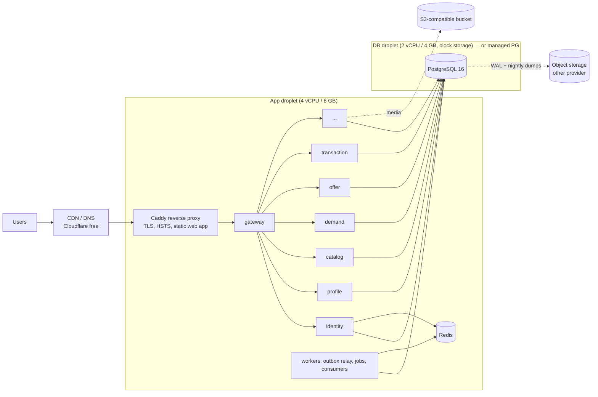

# 07 — Operations: Deployment, CI/CD, Testing, Observability, Cost

## 1. Deployment architecture

Everything ships as OCI images and runs anywhere Docker runs. No Kubernetes
until there is an operational reason (≥ ~10 hosts, autoscaling needs, or team
size).

### Stage 1 (launch) — single region, cost-first

- `docker compose` with per-environment override files, deployed by CI over
  SSH (or a tiny agent such as Watchtower pinned to tags). Services are small
  Node processes (~80–150 MB RSS each).
- Staging is the same topology on one smaller droplet.
- Postgres on its own host (or managed) from day one so app hosts are
  disposable.

### Stage 2+

Multiple app hosts behind a load balancer; services scaled independently
(`compose --scale` or Nomad/Kubernetes when justified); Postgres primary +
streaming replica (read replicas for search/feeds); Redis with persistence
off and a replica; OTel collector → Prometheus/Grafana/Loki/Tempo.

### Environments & config

| Env         | Purpose                            | Data                 |
| ----------- | ---------------------------------- | -------------------- |
| development | laptops, compose                   | seeds + demo data    |
| test/CI     | ephemeral containers               | created per run      |
| staging     | release candidates, restore drills | anonymized/synthetic |
| production  | live                               | real                 |

Config is 12-factor env vars, validated at boot with Zod; secrets come from
the platform's secret store (DO App secrets / AWS SM / Doppler / SOPS-encrypted
files) — never from git. `.env.example` documents every variable.

## 2. CI/CD

```mermaid
flowchart LR
  PR[Pull request] --> L[lint + format] --> T[typecheck] --> U[unit tests] --> I[integration tests<br/>Postgres + Redis services] --> M[migrations up/down/up] --> B[build] --> SEC[security: pnpm audit, osv-scanner, gitleaks, Trivy] --> D[docker build<br/>tag = git sha]
  D --> MAIN{merge to main}
  MAIN --> STG[deploy staging<br/>migrate job → rolling restart] --> E2E[Playwright E2E + k6 smoke] --> APPROVE[manual approval] --> PROD[deploy prod<br/>same image digest]
  PROD --> SMK[smoke + health gates] -->|fail| RB[rollback to previous tag]
```

- Turborepo-style affected builds via `pnpm --filter "...[origin/main]"` so a
  change to one service doesn't rebuild everything.
- Images are immutable, tagged `sha-<gitsha>` and `vX.Y.Z`; prod deploys pin
  the digest. Rollback = redeploy previous tag (migrations are
  backward-compatible by the expand/contract rule, so old code runs on the new
  schema).
- Production deploy requires green CI on the exact commit + environment
  protection approval.

## 3. Testing strategy

| Level          | Tooling                                               | What                                                                                                                                                                                                  | Gate                          |
| -------------- | ----------------------------------------------------- | ----------------------------------------------------------------------------------------------------------------------------------------------------------------------------------------------------- | ----------------------------- |
| Unit           | Vitest                                                | domain rules, state machines (exhaustive transition tables), phone normalization, pricing, matching scorers, authorization policies                                                                   | every PR, ≥ 90 % on `domain/` |
| Integration    | Vitest + real Postgres/Redis (compose services in CI) | repositories, migrations, outbox/inbox, locking/concurrency, rate limits                                                                                                                              | every PR                      |
| API / contract | Vitest + `fastify.inject`                             | request/response schemas, authn/z matrix (each route × role), error envelope, idempotency                                                                                                             | every PR                      |
| Concurrency    | Vitest with N parallel connections                    | double acceptance, bid races, double booking                                                                                                                                                          | every PR                      |
| E2E            | Playwright                                            | Register → OTP → profile → Post Need → receive offer → negotiate → accept → transaction → complete → review; Create listing → matched need → submit offer; Phase 2: auction → concurrent bids → close | staging, nightly              |
| Load           | k6                                                    | see targets below                                                                                                                                                                                     | weekly + before releases      |
| Security       | ZAP baseline on staging, dependency + secret scanning |                                                                                                                                                                                                       | nightly                       |

OTP in tests: a `RecordingSmsProvider` captures messages in-process for
integration tests; E2E uses the `file` SMS provider (dev/staging only — boot
fails if configured in production) and reads the code from the outbox file.

### Performance targets (Stage 1, per-service, at 200 RPS sustained on the Stage-1 hardware)

| Endpoint class                                        | p50     | p95      | p99      | error rate           |
| ----------------------------------------------------- | ------- | -------- | -------- | -------------------- |
| Reads by ID                                           | < 15 ms | < 50 ms  | < 120 ms | < 0.1 %              |
| Feeds / search                                        | < 40 ms | < 150 ms | < 300 ms | < 0.1 %              |
| Writes (need/offer/listing)                           | < 30 ms | < 120 ms | < 250 ms | < 0.1 %              |
| Bid placement (100 concurrent bidders on one auction) | < 40 ms | < 200 ms | < 400 ms | 0 incorrect outcomes |
| OTP request (excl. SMS provider latency)              | < 30 ms | < 100 ms | < 200 ms | —                    |

## 4. Observability

- **Logs**: pino JSON to stdout; fields `time, level, service, env, version,
requestId, correlationId, actorId (when authenticated), route, statusCode,
durationMs`. Redaction list for secrets/PII (see 04-security). Shipped by
  the platform (Docker log driver → Loki/Better Stack).
- **Correlation**: gateway assigns `X-Request-Id` and `X-Correlation-Id`;
  services propagate them on outbound HTTP and into event envelopes;
  consumers set them in their log context — one ID follows a Need from POST to
  the seller's notification.
- **Metrics**: `/metrics` (Prometheus format, internal port) with RED metrics
  per route (`http_request_duration_seconds` histogram), DB pool & query
  latency, Redis latency, outbox lag (`outbox_unpublished_count`,
  oldest age), consumer lag & DLQ size, OTP sends / SMS spend, cache hit
  ratio.
- **Tracing**: OpenTelemetry SDK wired in the kernel, disabled by default
  (`OTEL_EXPORTER_OTLP_ENDPOINT` enables it) → Tempo/Jaeger.
- **Health**: `GET /health/live` (process up), `GET /health/ready` (DB + Redis
  reachable, migrations at expected version). Load balancers use readiness;
  graceful shutdown flips readiness to failing, drains in-flight requests
  (`SHUTDOWN_GRACE_MS`), closes pools.
- **Errors**: Sentry-compatible (GlitchTip self-hosted is the cost-free option).
- **Alerts**: p95 SLO burn, 5xx rate, outbox lag > 60 s, DLQ > 0, SMS spend
  spike, backup job failure, restore drill failure, disk > 80 %.

## 5. Cost plan

Bangladesh-market launch, assume ≤ 50k MAU in year one.

| Item                     | Stage 1 choice                                                                                            | ~USD / month   |
| ------------------------ | --------------------------------------------------------------------------------------------------------- | -------------- |
| App host                 | 1× DO droplet 4 vCPU / 8 GB                                                                               | 48             |
| Database                 | 1× droplet 2 vCPU / 4 GB + 100 GB volume (self-managed PG + pgBackRest) **or** DO Managed PG basic (~$30) | 24–30          |
| Redis                    | on app host (no persistence needed)                                                                       | 0              |
| Object storage + CDN     | DO Spaces 250 GB (or Cloudflare R2: zero egress)                                                          | 5              |
| Backups (other provider) | Backblaze B2 / R2                                                                                         | 1–3            |
| Staging                  | 1× droplet 2 vCPU / 4 GB                                                                                  | 24             |
| DNS/CDN/WAF              | Cloudflare free                                                                                           | 0              |
| Monitoring               | Grafana Cloud free tier / self-hosted on staging                                                          | 0              |
| SMS                      | per message (BD aggregators ≈ BDT 0.25–0.50)                                                              | usage          |
| **Total (excl. SMS)**    |                                                                                                           | **≈ $100–110** |

Scale-up triggers (measure, then spend): DB CPU > 60 % sustained or p95 query
latency over target → bigger DB / read replica; app CPU > 60 % → second app
host + LB; FTS p95 > 150 ms on feeds → evaluate Meilisearch. Managed Postgres
becomes worth it when on-call time for DB ops exceeds its premium.
